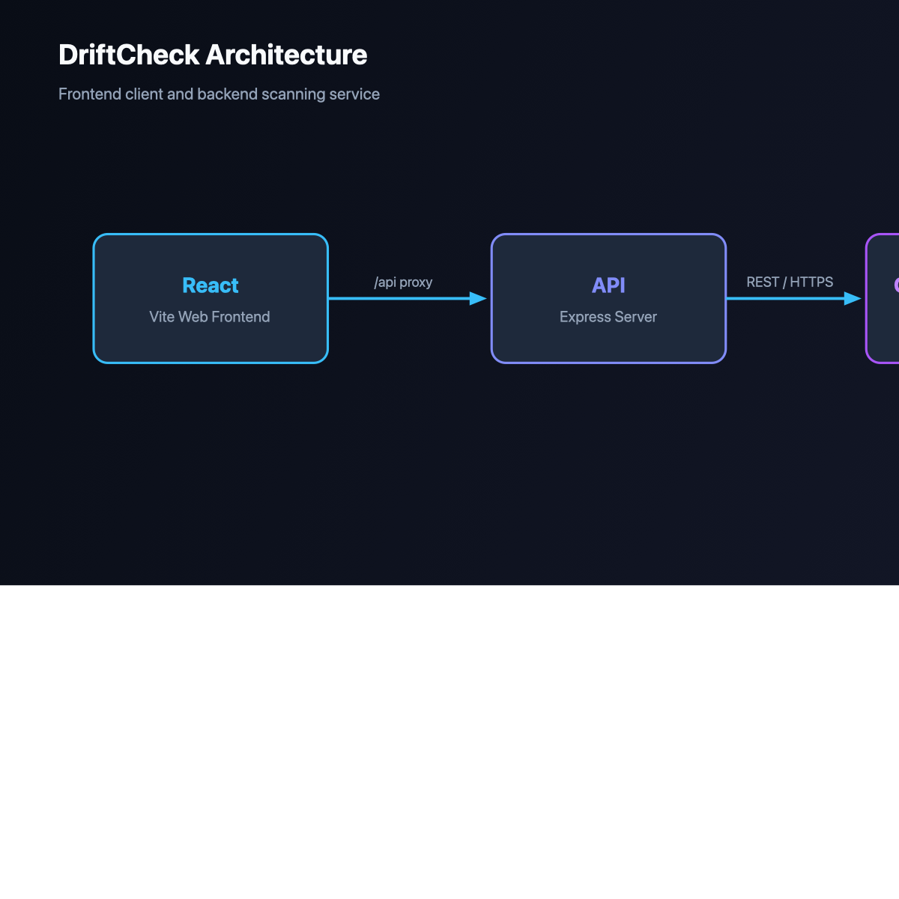

# DriftCheck 🔍⚡

> **Architecture Drift Detector**: Compare your architecture diagram against your actual GitHub repository to automatically surface drift, missing services, and undocumented dependencies with file-and-line evidence.



---

## 🎯 What DriftCheck Is

Architecture diagrams easily rot. DriftCheck continuously reconciles your intended architecture against your live codebase with a strict **AI / Non-AI split**:

1. **Gemma 4 (Vision)**: Extracts `{ components, connections }` from diagram images (draw.io, Mermaid exports, whiteboards, PNG/JPG).
2. **Deterministic Scanner**: Pure JavaScript pattern matcher scans the codebase across package dependencies, `docker-compose.yml`, `.env.example`, and source imports. **Zero AI in the scanner.** Returns `match`, `mismatch`, `undocumented`, and `unknown` with concrete file and line evidence.
3. **Gemma 4 (Text)**: Drafts GitHub issues from verified facts only. Concrete evidence tables with file lines and snippets are appended deterministically by code.

---

## 📸 Screenshots & UI Flow

```
[ Step 1: Upload & Target ]  ──►  [ Step 2: Review Extraction ]  ──►  [ Step 3: Scan Findings ]  ──►  [ Step 4: Dispatch Issues ]
   Diagram + GitHub Repo            Adjust/Confirm Components             Evidence + Metric Cards        AI Prose + Appended Evidence
```

- **Step 1 — Upload**: Drag-and-drop architecture diagram and enter GitHub repository URL (or local directory).
- **Step 2 — Review**: Human-in-the-loop review of extracted components and relationships.
- **Step 3 — Findings**: Visual results showing diagram thumbnail, colored metrics cards (Match, Mismatch, Undocumented, Unknown), line-by-line evidence citations, and heuristic connection checks.
- **Step 4 — Issues**: One-click issue drafting with factual evidence appended and GitHub dry-run simulation.

---

## 🚀 How to Demo in 90 Seconds

DriftCheck ships with a self-contained demonstration repository at `demo/planted-drift/` containing 3 planted architectural differences:
- **No Redis anywhere**: Declared in diagram, absent from codebase (`mismatch`)
- **MongoDB instead of Postgres**: Postgres missing (`mismatch`), MongoDB active (`undocumented`)
- **RabbitMQ present**: Used in code and docker-compose, missing from diagram (`undocumented`)

### 1. Start the Backend
```bash
cd backend
npm install
npm run dev
# Server running on http://localhost:3001
```

### 2. Start the Frontend
```bash
cd frontend
npm install
npm run dev
# Vite dev server running on http://localhost:5173
```

### 3. Run the Demo Flow in Browser
1. Open **http://localhost:5173** in your browser.
2. Click **"Load Planted-Drift Demo Setup"** (loads the sample diagram and `demo/planted-drift`).
3. Click **"Extract Components with Gemma 4"** (or proceed to review).
4. In Step 2, review the 5 components: `React`, `API`, `Postgres`, `Redis`, `Stripe`.
5. Click **"Scan Repository for Evidence"**.
6. Observe the results:
   - ✅ **Matches (3)**: React, API, Stripe (with file+line snippets)
   - ❌ **Mismatches (2)**: Redis, Postgres (0 evidence found)
   - ⚠️ **Undocumented (2)**: MongoDB, RabbitMQ (discovered in `package.json`, `index.js`, `docker-compose.yml`, `.env.example`)
7. Click **"Copy Markdown Report"** to copy the full audit report to your clipboard.
8. Click **"Draft GitHub Issues with Gemma 4"**:
   - Preview the issues drafted with deterministic evidence attached.
   - Click **"Dry-Run Issue"** to simulate issue creation without publishing.

---

## 🤖 Model Setup & Smoke Test (Gemma 4)

DriftCheck supports both **Google Gemini API** and **OpenAI-compatible endpoints** (OpenRouter, Ollama, vLLM).

### Environment Configuration (`backend/.env`)

#### Option A: Google Gemini API (Recommended for Cloud)
```env
PORT=3001
LLM_PROVIDER=gemini
LLM_MODEL=gemini-2.5-flash
GEMINI_API_KEY=your_gemini_api_key_here
```

#### Option B: Gemma 4 via OpenAI-Compatible Host (OpenRouter / Ollama)
```env
PORT=3001
LLM_PROVIDER=openai
LLM_BASE_URL=https://openrouter.ai/api/v1
LLM_MODEL=google/gemma-4-31b-it
OPENAI_API_KEY=your_openrouter_api_key_here
```

*For local Ollama*:
```env
LLM_PROVIDER=openai
LLM_BASE_URL=http://localhost:11434/v1
LLM_MODEL=gemma4:latest
OPENAI_API_KEY=
```

### Running the Model Smoke Test
Run the smoke test to verify model extraction against a local diagram image:
```bash
cd backend
node scripts/smoke.js
```
The script reads `demo/planted-drift/diagram.png`, submits it to `extractDiagram()`, and outputs the extracted `{ components, connections }` JSON. If an API key is missing or invalid, it surfaces the real error message and troubleshooting steps.

---

## 🛡️ Self-Check Architecture Audit

DriftCheck can audit its own architecture!
```bash
npm run self-check
```
This runs the deterministic scanner against `docs/architecture.png` and DriftCheck's repository. It verifies:
- `React` client (frontend)
- `Express API` server (backend)
- Asserts **0 mismatches**.

---

## 🧪 Testing

DriftCheck includes comprehensive unit tests verifying scanner behavior, monorepo support, `.env.example`, `docker-compose.yml`, `require()` statements, unknown component handling, and the planted drift fixture:

```bash
cd backend
npm test
```

Test suite coverage:
- `identifies matched component when dependency exists in package.json`
- `flags mismatch when declared component is absent from codebase`
- `detects component from docker-compose.yml definition`
- `detects component from .env.example configuration keys`
- `detects component from CommonJS require() import statement`
- `detects component inside monorepo subdirectory apps/api/package.json`
- `marks unknown component without signature as unknown, never match`
- `detects extended signatures (Supabase, Prisma, Neon, Sentry, Auth0)`
- `detects all 3 planted architectural differences in demo/planted-drift`

---

## 🔒 Security & Privacy

- **Never logs or stores secrets**: GitHub Personal Access Tokens and LLM API keys are never written to logs or persisted in databases.
- **Client-Side Dry-Run**: Simulated testing before posting issues to GitHub repositories.
- **Gitignored credentials**: All `.env` files are strictly excluded via `.gitignore`.
